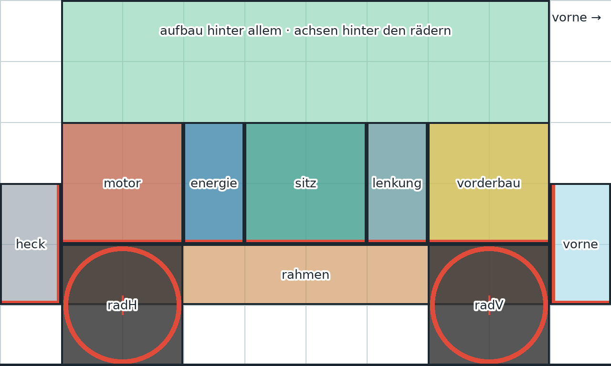
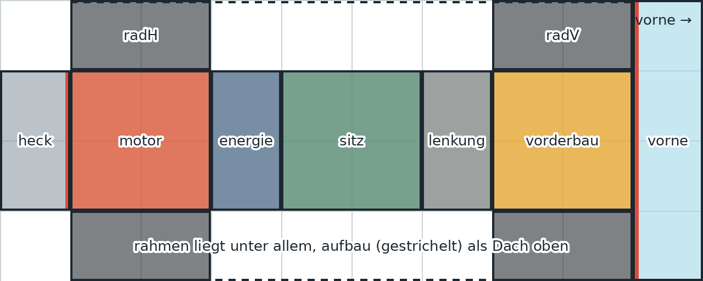

# Klapperkiste – Teile-Raster & Asset-Bibel

Damit jedes Teil zu jedem anderen passt, egal was man einbaut, entstehen alle
Teile nach denselben Regeln. Die Maße stehen maschinenlesbar in
[`raster.json`](raster.json). Spiel, Vorlagen und Werkzeug lesen alle aus
dieser Datei.

## 1. Das Raster

- **1 Zelle = 128 × 128 px** im fertigen Bild.
- Ein Auto ist in der **Seitenansicht 10 × 6 Zellen** (1280 × 768 px) groß,
  in der **Draufsicht 10 × 4 Zellen** (1280 × 512 px).
- **Vorne ist immer rechts**, in beiden Ansichten.
- Jede Kategorie hat eine **feste Box**. Ein Motor ist immer 2 × 2 Zellen,
  egal ob Rasenmäher oder V8. Deshalb passt jeder Motor auf jeden Rahmen.




| Kategorie | Seite (Zellen) | Seite (px) | Draufsicht (Zellen) | Draufsicht (px) | Kontaktkante |
|---|---|---|---|---|---|
| Rahmen | 8 × 1 | 1024 × 128 | 8 × 2 | 1024 × 256 | wird exakt auf die Box gestreckt |
| Rad | 2 × 2 | 256 × 256 | 2 × 1 | 256 × 128 | wird exakt auf die Box gestreckt, Nabe in der Mitte |
| Motor | 2 × 2 | 256 × 256 | 2 × 2 | 256 × 256 | unten (steht auf dem Rahmen) |
| Energie | 1 × 2 | 128 × 256 | 1 × 2 | 128 × 256 | unten |
| Sitz | 2 × 2 | 256 × 256 | 2 × 2 | 256 × 256 | unten, **ohne Fahrer** |
| Lenkung | 1 × 2 | 128 × 256 | 1 × 2 | 128 × 256 | unten |
| Vorderbau | 2 × 2 | 256 × 256 | 2 × 2 | 256 × 256 | unten (Lampen, Hupe, Kühler …) |
| Vorne | 1 × 2 | 128 × 256 | 1 × 4 | 128 × 512 | links (hängt am Rahmenende) |
| Heck | 1 × 2 | 128 × 256 | 1 × 2 | 128 × 256 | rechts (hängt am Rahmenende) |
| Aufbau | 8 × 4 | 1024 × 512 | 8 × 4 | 1024 × 512 | unten, liegt hinter allem |

Die roten Linien in den Vorlagen (`vorlagen/vorlage_<kategorie>_<ansicht>.png`)
zeigen, welche Kante das Teil berühren muss.

## 2. Bildregeln (gelten für jedes Teil)

1. **Ein Teil pro Bild**, mittig, füllt das Bild gut aus.
2. **Einfarbiger, heller Hintergrund** (am besten reines Weiß), kein
   Bodenschatten, keine Schrift, keine Personen.
3. **Licht immer von oben links.**
4. **Seitenansicht:** genau im Profil, vorne zeigt nach rechts. Die Kamera
   schaut nur ganz leicht von oben (ca. 15°), sodass die Oberseite gerade
   noch sichtbar ist. Das gibt den 3D-Eindruck, ohne dass die Teile beim
   Zusammensetzen schief wirken.
5. **Draufsicht:** senkrecht von oben, ohne Perspektive, vorne zeigt nach rechts.
6. **Seitenverhältnis** passend zur Box erzeugen (siehe Tabelle), z. B.
   Motor 1:1, Tank 1:2 hochkant, Rad in der Draufsicht 2:1.
7. **Gleicher Stil-Block** in jedem Prompt (siehe unten), damit alles
   zusammen aussieht.
8. **Comic-Look:** gleich dicke schwarze Konturen, flache Farben mit einem
   Schattenton. Keine Raster- oder Punktmuster, vor allem nicht im
   Hintergrund, sonst klappt das Freistellen schlecht.

## 3. Ablauf für ein neues Teil

1. Prompt aus Abschnitt 4 nehmen, Teil einsetzen, Bild erzeugen.
2. Optional: Hintergrund im Bildprogramm entfernen. Das Werkzeug kann
   einfarbige Hintergründe aber auch selbst entfernen, auch eingeschlossene
   Löcher (z. B. innerhalb einer Seilschlaufe). Reinweiße Flächen am Teil
   selbst würden dabei als Loch gelten. Im Comic-Look sind sie meist leicht
   getönt und bleiben deshalb stehen. Sonst mit `--keine-inseln` einpassen.
3. Einpassen. Das Werkzeug stellt frei, schneidet zu, skaliert und setzt das
   Teil exakt an die Kontaktkante:
   ```bash
   python klapperkiste/tools/teilwerk.py einpassen roh.png motor seite assets/teile/maeher/seite.png
   python klapperkiste/tools/teilwerk.py einpassen roh_oben.png motor oben assets/teile/maeher/oben.png
   ```
4. Probe-Zusammenbau, um zu sehen, ob alles passt:
   ```bash
   python klapperkiste/tools/teilwerk.py bauen seite probe.png \
     rahmen=assets/teile/bettgestell/seite.png motor=assets/teile/maeher/seite.png \
     radH=assets/teile/schubkarre/seite.png radV=assets/teile/schubkarre/seite.png
   ```
5. Ablage: `klapperkiste/assets/teile/<teil-id>/seite.png` und `oben.png`.

## 4. Prompt-Vorlagen

Bildgeneratoren verstehen Englisch zuverlässiger, deshalb sind die Prompts
englisch. `[TEIL]` wird durch die Beschreibung des Teils ersetzt.

**Stil-Block Comic-Look (immer gleich):**

```
Comic book illustration, bold uniform black ink outlines, flat cel-shaded colours with one clear
shadow tone and small white highlights, bright saturated but warm palette, slightly exaggerated
chunky cartoon proportions, light coming from the upper left.
Single object, isolated and centred on a plain flat white background, filling most of the frame.
No ground shadow, no text, no people, no other objects.
```

**Seitenansicht:**

```
[TEIL], strict side view in profile, the front points to the right, camera at object height
tilted down only very slightly so the top surface is barely visible. + Stil-Block
```

**Draufsicht:**

```
[TEIL], seen straight from directly above, orthographic top-down view without perspective,
the front points to the right. + Stil-Block
```

## 5. Erste Serie: die Schrottkarre (Karrierestart)

Mit diesem Auto beginnt die Karriere: Es fährt gerade so bis zum
Schrottplatz. 6 Teile, je 2 Ansichten = 12 Bilder. Alle 12 fertigen Prompts
mit Kopier-Knopf, Format und Dateinamen stehen in
[`design/prompts.html`](../design/prompts.html). Die Reihenfolge dort ist
auch die empfohlene Reihenfolge: zuerst den Motor als Stil-Referenz.

| Nr. | ID | Kategorie | Teil | Format Seite / Oben |
|---|---|---|---|---|
| 1 | `maeher` | Motor | Rasenmäher-Motor | 1:1 / 1:1 |
| 2 | `schubkarre` | Rad | Schubkarrenrad | 1:1 / 2:1 |
| 3 | `bettgestell` | Rahmen | Rahmen aus einem alten Metall-Bettgestell | 21:9 / 4:1 |
| 4 | `giesskanne` | Energie | Gießkanne als Tank | 1:2 / 1:2 |
| 5 | `kuechenstuhl` | Sitz | Küchenstuhl (Lehne hinten = links) | 1:1 / 1:1 |
| 6 | `fahrradlenker` | Lenkung | Fahrradlenker (Griffe zeigen nach hinten = links) | 1:2 / 1:2 |

Dateinamen: `<id>_seite.png` und `<id>_oben.png`, z. B. `maeher_seite.png`.

## 6. Was später dazukommt

- **Fahrerfigur** als eigenes Bild (Seite und oben), sitzt auf jedem Sitz.
- **Werkstatt-Hintergrund** als gemaltes Bild mit Raumtiefe (3D-Wirkung), das
  Auto steht davor auf der Hebebühne.
- **Karten-Raster** für die große Draufsicht-Karte: kommt mit Phase B, sobald
  die Fahrphysik von oben steht.
