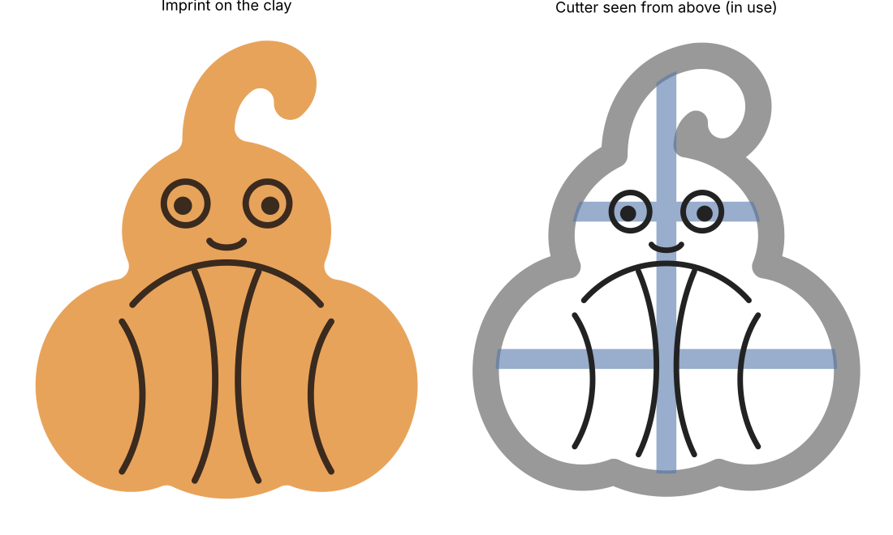

# Pumpkaboo clay cutter

A 3D-printable cutter in the shape of Pumpkaboo, made for pottery: a lobed pumpkin body with the ghost head peeking out and its curly hair tuft.



## Files

| File | What it is |
|---|---|
| `pumpkaboo_cutter_stamp.stl` | Cuts the outline **and** presses the details (eyes, smile, pumpkin rim and ridges) into the clay in one push. |
| `pumpkaboo_cutter_outline.stl` | Outline only. The clay comes out more easily, and you can carve or stamp the details by hand. |
| `make_cutter.py` | Generator script. Change the parameters at the top and run it to rebuild the STLs. |

The cut shape is **84 × 101 mm**. With the flange the part is 97 × 114 mm and 25 mm tall.

## Printing

- Print with the **flange flat on the bed** (the orientation the STL already has). No supports needed.
- Layer height 0.2 mm. Use at least 3 perimeters, or "detect thin walls". The cutting edge is 0.9 mm (two lines with a 0.4 mm nozzle).
- PLA works fine. PETG holds up better if you wash it with warm water.

## Using it with clay

- The details are set for a **6 mm slab** and press about **2 mm** deep. For a different slab thickness, set `SLAB` (and `IMPRINT` if you want) in `make_cutter.py` and run `python3 make_cutter.py`.
- The design is mirrored in the model on purpose, so the curl of the tuft points the right way on the clay once you flip the cutter blade-down.
- Dust the cutter with cornstarch, or put a piece of plastic wrap over the slab before pressing (this also gives softer, rounded imprint edges). Either way the clay releases more cleanly.
- Clay shrinks about 10–15 % from drying and firing. To get a finished piece of a certain size, raise `SCALE` to make up for it (e.g. `SCALE = 1.15`).

## Rebuilding

```bash
pip install shapely manifold3d trimesh numpy matplotlib
python3 make_cutter.py
```
